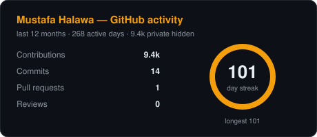
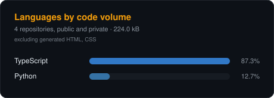
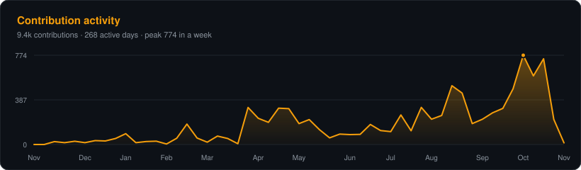

# readme-cards

**GitHub profile stat cards that live in your repository, not on someone else's server.**

[](https://github.com/eclipseagency/readme-cards/actions/workflows/ci.yml)
[](LICENSE)


---

## The problem

The three most-used README card services are returning errors right now, for everyone:

| Service | Status |
|---|---|
| `github-readme-stats.vercel.app` | **503** |
| `github-profile-trophy.vercel.app` | **402 Payment Required** |
| `github-readme-activity-graph.vercel.app` | **402 Payment Required** |

Check for yourself:

```bash
curl -o /dev/null -s -w '%{http_code}\n' \
  "https://github-readme-stats.vercel.app/api?username=octocat"
```

Thousands of profiles are serving broken images and their owners have no idea, because
nobody reloads their own profile. That is the failure mode of rendering your profile
through a free service you do not control: when its bill lapses or its rate limit trips,
your profile breaks silently and permanently.

There is a second, quieter problem. Those services authenticate as themselves, so they
only ever see your **public** repositories. If your work is in private repos — most
professional work is — the language card reports almost nothing.

## The fix

`readme-cards` runs inside **your** GitHub Actions, reads **your** data with **your**
token, and commits plain SVG files to **your** repository. Your README then points at
raw files in your own repo.

- **Cannot go down.** No runtime dependency on any third party. The SVG is already committed.
- **Sees private repositories.** Give it a PAT with `repo` scope and the language card
  covers everything you own, not just what is public.
- **Zero dependencies.** Standard-library Python. No `node_modules`, no lockfile, no supply chain.
- **Readable output.** Hand-written SVG, about 600 lines total. Fork it and change a colour.

## Cards






## Quick start

Create `.github/workflows/cards.yml` in any repository — your profile repo is the
obvious one:

```yaml
name: Profile cards

on:
  schedule: [{ cron: "0 3 * * *" }]
  workflow_dispatch:

permissions:
  contents: write

jobs:
  cards:
    runs-on: ubuntu-latest
    steps:
      - uses: actions/checkout@v4
      - uses: eclipseagency/readme-cards@v1
        with:
          theme: dark
          accent: "#f59e0b"
```

Then reference the committed files from your README:

```markdown


```

### Including private repositories

The default `GITHUB_TOKEN` can only see public repositories. For a language card that
reflects all your work, create a [fine-grained or classic PAT][pat] with read access to
your repositories, save it as a repository secret, and pass it:

```yaml
      - uses: eclipseagency/readme-cards@v1
        with:
          token: ${{ secrets.CARDS_TOKEN }}
```

[pat]: https://docs.github.com/en/authentication/keeping-your-account-secure/managing-your-personal-access-tokens

## Options

| Input | Default | Description |
|---|---|---|
| `token` | `${{ github.token }}` | PAT with `repo` scope to include private repositories |
| `user` | repository owner | Login to render |
| `cards` | `stats,languages,activity` | Which cards to generate |
| `theme` | `dark` | `dark`, `light`, `gruvbox`, `dracula`, `nord`, `midnight` |
| `accent` | theme default | Hex accent override, e.g. `"#f59e0b"` |
| `output_dir` | `cards` | Where the SVGs are written |
| `exclude_languages` | `HTML,CSS` | Dropped from the language card — see below |
| `badge` | `true` | Also write `contributions.json`, a shields.io endpoint |
| `commit` | `true` | Commit and push when the cards change |

### Why `HTML,CSS` is excluded by default

GitHub counts language **bytes**, and build output counts. A repo holding a static site
export or a vendored CMS can carry tens of megabytes of generated HTML, which then
dominates the chart and reports you as an HTML developer. The card states the exclusion
in its subtitle so the number stays honest. Pass `exclude_languages: ""` to keep everything.

### Your contribution graph may be understating you

If your work is in private repositories, your public contribution graph shows almost
nothing unless you opt in. The CLI warns you when it detects this:

> note: 9,358 contributions are hidden because 'Include private contributions on my
> profile' is off.

Turn it on at **Settings → Public profile → Contributions & activity**. GitHub shows the
counts and the heatmap only — no repository, organisation or client name is ever exposed.

## Local use

No installation, no dependencies:

```bash
git clone https://github.com/eclipseagency/readme-cards
cd readme-cards
GITHUB_TOKEN=$(gh auth token) ./bin/readme-cards --user <you> --out cards --badge
```

```
--user              GitHub login to render        (required)
--cards             stats,languages,activity
--theme             dark | light | gruvbox | dracula | nord | midnight
--accent            hex override, e.g. #f59e0b
--out               output directory              (default: cards)
--exclude-languages default: HTML,CSS
--language-limit    default: 8
--badge             also write contributions.json
```

## What it does not do

- **No trophies.** A trophy case rewards volume, not engineering. Not worth rendering.
- **No all-time stats.** GitHub's contributions API is scoped to a rolling 12 months;
  anything claiming an all-time commit count is estimating. These cards say
  "last 12 months" because that is what the data supports.
- **No server.** There is nothing to deploy and nothing to pay for. That is the point.

## Contributing

Issues and pull requests are welcome — new themes and new card types especially.
`python3 -m unittest discover tests -v` runs the suite; it needs no network and no token.

## License

MIT © Mustafa Halawa
